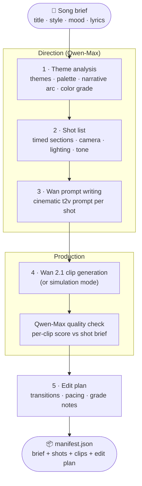

# MusicVid AI 🎬

**An autonomous music video director — from song brief to shot list to Wan-generated clips to edit plan, end to end.**

[](LICENSE)
[](tsconfig.json)
[](https://www.alibabacloud.com/en/solutions/generative-ai/qwen)
[](#wan-integration)
[](#)

Give it a song title, artist style, mood, and (optionally) lyrics — it thinks like a director: extracts the visual theme, storyboards a timed shot list, writes cinematic text-to-video prompts, generates clips via **Wan 2.1**, quality-checks each one, and produces a final edit plan and manifest ready for an editor (or an automated cut).

---

## Table of Contents

- [Architecture](#architecture)
- [The Five Stages](#the-five-stages)
- [Wan Integration](#wan-integration)
- [Quick Start](#quick-start)
- [Configuration](#configuration)
- [Output](#output)
- [Project Structure](#project-structure)
- [License](#license)

---

## Architecture



## The Five Stages

1. **Theme analysis** — Qwen-Max reads the song brief and lyrics and produces a thematic brief: themes, visual palette, narrative arc, color grade, overall style.
2. **Shot list** — a director-persona prompt turns the brief into a timed shot list (section, start/end seconds, description, camera movement and angle, lighting, emotional tone) summing to the target duration.
3. **Prompt writing** — each shot becomes a disciplined Wan text-to-video prompt: style lock, camera, lighting, mood, duration cue, and negative constraints (no text, no watermarks).
4. **Clip generation + QC** — the Wan adapter generates each clip; Qwen-Max scores every clip description against its shot brief.
5. **Edit plan + manifest** — transitions, pacing, and grading notes, then everything is written to `manifest.json`.

## Wan Integration

The `WanClient` speaks to a Wan 2.1 text-to-video endpoint (`wan-2.1-t2v-14b`, 1280×720, 81 frames) with async job polling and clip download.

**No Wan key? It still runs.** Without `WAN_API_KEY` the adapter enters **simulation mode**: it writes each shot's full prompt as a placeholder file so the entire pipeline — theme, shots, prompts, QC, edit plan, manifest — remains testable for free.

## Quick Start

**Prerequisites:** Node.js 18+, a [Qwen Cloud API key](https://www.alibabacloud.com/en/product/modelstudio). Wan key optional.

```bash
git clone https://github.com/manojmallick/musicvid-ai.git
cd musicvid-ai
npm install

cp .env.example .env        # add QWEN_API_KEY (and optionally WAN_API_KEY)

npm run dev                 # full pipeline on a sample song brief
```

## Configuration

| Variable | Default | Purpose |
|---|---|---|
| `QWEN_API_KEY` | — (required) | Qwen Cloud API key |
| `QWEN_BASE_URL` | `https://dashscope.aliyuncs.com/compatible-mode/v1` | OpenAI-compatible endpoint |
| `WAN_API_KEY` | — (optional) | Enables real video generation; absent → simulation mode |
| `WAN_BASE_URL` | `https://api.wan.video/v1` | Wan endpoint |

## Output

```
musicvid_output/
├── clips/
│   ├── shot_001.mp4        # real mode — or shot_001.txt (prompt) in simulation
│   └── ...
└── manifest.json           # theme brief, timed shots, quality scores, edit plan
```

## Use Your Own Song

`npm run dev` runs a demo for "Fade Into You". To direct your own video, build the project and call the class from your code:

```ts
import { MusicVidAI } from "./dist/index";

const ai = new MusicVidAI();
const video = await ai.produce(
  "Song title",
  "Artist style",     // e.g. "dreamy shoegaze"
  "melancholic",      // mood
  60,                 // target duration in seconds
  "optional lyrics",
  "musicvid_output"   // output directory (default)
);
console.log(video.manifestPath, video.shots.length);
```

`produce()` runs all five stages and writes `manifest.json` (plus clips, or prompt placeholders in simulation mode) to the output directory. The individual stages (`analyzeTheme`, `createShotList`, `shotToWanPrompt`, `generateClips`, `createEditPlan`) are public if you want to run them separately.

### Scripts

| Command | What it does |
|---|---|
| `npm run dev` | Run `src/index.ts` with ts-node (the built-in demo) |
| `npm run build` | Compile TypeScript to `dist/` |
| `npm start` | Run the compiled build (`node dist/index.js`) |

### Limitations

- The command-line entry point only runs the built-in demo; to use your own input, call the class from your code as shown above.
- There are no automated tests. Quality depends on the Qwen model's output, which varies between runs.

## Project Structure

```
musicvid-ai/
├── src/
│   ├── index.ts        # MusicVidAI — 5-stage direction pipeline
│   ├── wanClient.ts    # Wan 2.1 adapter with job polling + simulation mode
│   └── qwenClient.ts   # Qwen Cloud client with robust JSON handling
└── README.md
```

## License

[MIT](LICENSE) © 2026 Manoj Mallick · Built for the Qwen Cloud Hackathon, Track 2 (AI Showrunner).
